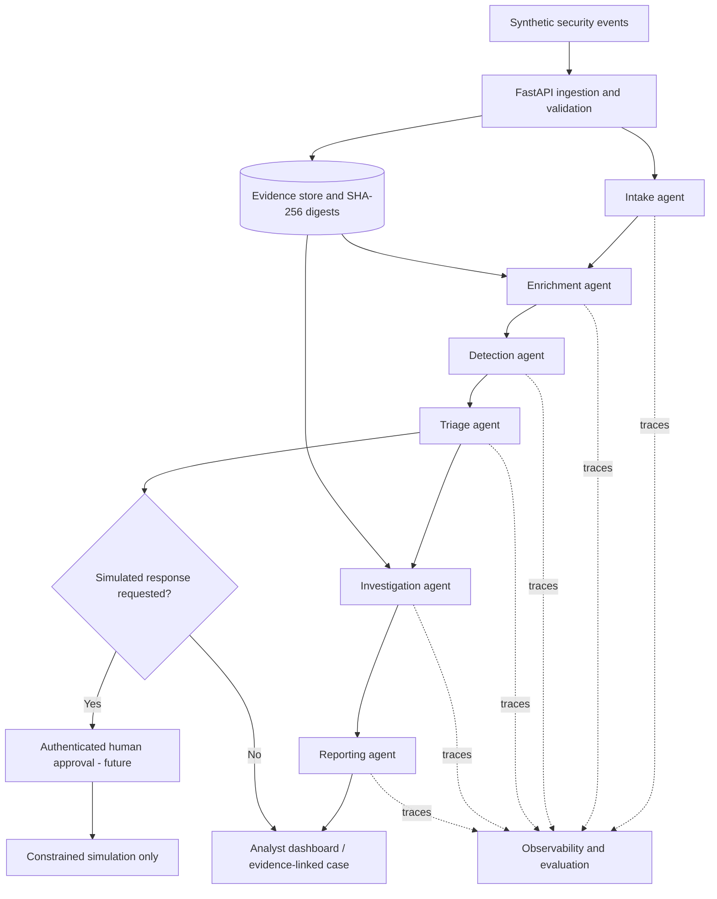
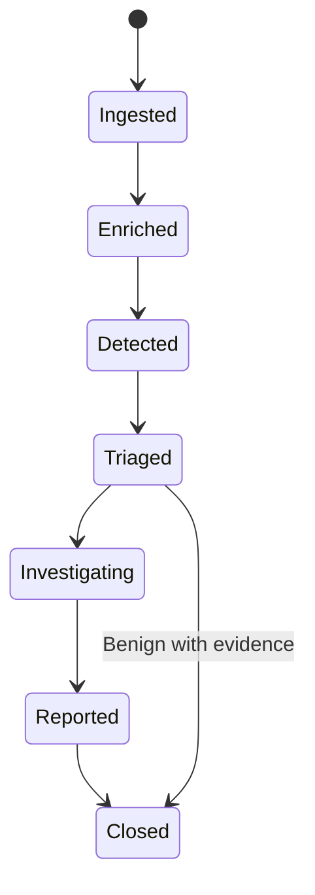
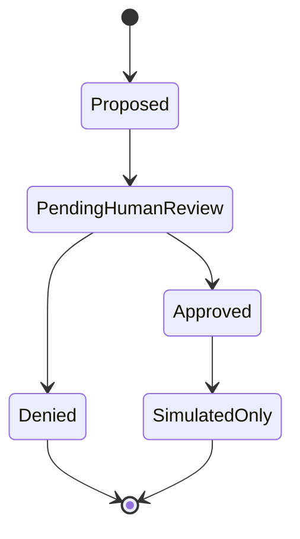

# CyberSOC AI — Competition Edition | Authoritative Master Plan

> Status: PLANNED / IMPLEMENTATION IN PROGRESS. This document is the single source of truth for scope, evidence, decisions, phase gates and competition deliverables. It is not proof that any planned capability exists.
> Updated: 2026-11-21. Owner: project maintainer. Change control: update this document and its traceability table in the same PR as any material scope change.

> Implementation update: the offline Competition Edition demo implements all six deterministic roles. See [local phase evidence](verification/COMPETITION_REVIEW.md) for verified results and remaining external gates. The entries below preserve the original plan and its planned targets.

> Current competition baseline, 2026-11-22. Use GPT-4.1 mini with the [Foundry operations and verification plan](verification/FOUNDRY_GPT41_ROLLOUT.md). The [Luna rollout ledger](verification/FOUNDRY_LUNA_ROLLOUT.md) records the previous quota work and the pending model switch.

## 1. Source inventory and precedence

Reviewed: seven `agent-architect-*-transcript.txt` lesson transcripts; user-provided screenshots of Lesson 8 Final Activity (steps 1–3 and submission screen); previous `CyberSOC-AI-Phase1.zip` and extracted repository including README, architecture, security baseline, review, API, schema, provider, repository, approval tests and CI workflow; Azure for Students and Foundry screenshots; GitHub repository URL provided by user. The [Microsoft FrontierWeekHack lab](https://github.com/microsoft/FrontierWeekHack) provides a reference implementation for the build, monitor, evaluate, and orchestrate exercises. The [project repository](https://github.com/ManeaAl-Shabrain/CyberSOC-AI) is the destination for this plan and code. No independent official judging rubric or deadline has been supplied. The screenshots show a three-minute video upload limit (150 MB, MP4/MOV/WebM) and a Word/PDF document requirement. Lesson 8 Step 3 lists both artifacts. The camera UI separately describes attaching a document in optional terms. Prepare both artifacts to satisfy the written assignment.

Precedence: (1) screenshots of actual final activity and its instructions; (2) course transcripts; (3) explicit user decisions (Competition Edition, security SOC domain, review gates); (4) existing prototype. Unverified enhancements are clearly labeled OPTIONAL, not mandatory competition criteria.

## 2. Exact final activity requirements (source-derived)

### Step 1 — Design your AI solution
- Choose a realistic business problem and intended users.
- Define at least two specialized agents with distinct responsibilities.
- Identify each agent's tools, data sources and knowledge bases.
- Explain why multi-agent is preferable to one agent.
- Clearly show information flow and each agent's contribution.

### Step 2 — Production-readiness plan
- Observability: traces, monitoring metrics, diagnosis and performance improvement.
- Evaluation: dataset/test approach; coherence, relevance, groundedness, task adherence, safety, fluency or tool usage as applicable; integration into development lifecycle.
- Governance/reliability: consistent output, safe behavior, maintainability, grounded sources and tools.

### Step 3 — End-to-end workflow
- Sequence of agent interactions and exchanged information.
- Tool calls and knowledge retrieval steps.
- Final output to user/business process.
- Deployment, monitoring, evaluation and ongoing improvement.

### Submission
- PDF or Word document describing design, architecture, observability, evaluation and workflow.
- Short recorded presentation demonstrating the proposed solution, design decisions and lessons from prototype-to-production.
- Video: up to 3 minutes and 150 MB; formats MP4, MOV or WebM shown in platform UI.
- Use diagrams/screenshots where helpful; do not disclose confidential, personal or sensitive data.
- IMPORTANT: Course wording asks for a **proposed production-ready architecture**. It does not establish that a live production deployment is required. Avoid presenting a mock as deployed.

## 3. Product concept, users and outcomes

**Name:** CyberSOC AI — Competition Edition.
**Problem:** Security teams face alert overload, fragmented context, inconsistent triage and slow evidence-backed reporting.
**Users:** SOC L1 analysts, incident responders, SOC leads and authorized reviewers.
**Value proposition:** Ingest synthetic security events; enrich context; correlate and triage; generate evidence-linked findings; request human approval for simulated actions; produce auditable case reports.
**Non-goals:** No live containment, credential harvesting, external scanning, autonomous production remediation, unapproved access to corporate logs or real customer data.
**Competition distinction (OPTIONAL):** demonstrate prompt-injection resilience, human oversight, evidence integrity, deterministic replay, safety evaluations and cost-aware observability. No claims about winning probability are supported by a judging rubric.

## 4. Agent responsibilities and boundaries

| Agent | Input | Tools/knowledge | Output | Safety |
|---|---|---|---|---|
| Intake | Synthetic SIEM event | schema validator, normalization rules | normalized event + evidence ID | reject malformed events |
| Enrichment | normalized event | synthetic asset inventory, mock CTI, rule lookup | contextual evidence | source citations required |
| Detection | events + enrichment | deterministic correlation rules / Sigma-inspired patterns | detection hypotheses | distinguish signals from facts |
| Triage | hypotheses + context | severity rubric, risk scoring | prioritized case | no automatic action |
| Investigation | case + linked evidence | timeline builder, retrieval, correlation | supported findings + uncertainty | untrusted logs are data only |
| Reporting | findings + evidence | case template, report renderer | analyst-ready report | no unsupported claims |

**Implementation status:** Phase 1 contains deterministic data/API components and an offline mock provider. For the first working demo, implement **Triage** and **Investigation** as distinct agents and use deterministic validation, retrieval, and report rendering. The six roles are the Competition Edition target. The assignment minimum is two specialized agents. The response proposal is assembled from an approved runbook by the workflow and reviewed by a human. Keep the six-role expansion contingent on a working two-agent demo and available time.

## 5. Architecture diagram

**Trust boundaries:** incoming logs are untrusted; knowledge/tool outputs must be validated; model output is advisory; authorization/approval must be enforced by backend policy, not a prompt; secrets remain server-side; the reporting boundary must redact sensitive material.

## 6. Case and approval state machines

Phase 1 approval code is not production identity-bound authorization. Any real-world executor remains disabled until authentication, RBAC, audit trail and negative tests are implemented and independently reviewed.

## 7. Data contracts and evidence

The current `SecurityEvent` shape is `event_id`, UTC `timestamp`, `source`, `event_type`, `asset_id`, `raw_data`, and `simulation`. The prototype hashes a deterministic JSON serialization of the validated event and stores it in in-memory SQLite by default. Severity belongs to the future case and triage outputs. Payload-size enforcement and cross-checking finding references against stored evidence still require implementation. Keep raw observations, hypotheses, and analyst decisions distinct. Define `Case`, `Finding`, `EvidenceRef`, `AgentTrace`, `ApprovalRequest`, `EvaluationResult` contracts before multi-agent integration. Evidence hashes are integrity checks, **not tamper-proof storage**. No real PII, credentials or customer logs in demos.

## 8. Microsoft technology mapping

- Microsoft Foundry: intended agent/model orchestration, evaluation and tracing, contingent on subscription/region/model quota.
- Azure for Students: screenshot confirms $100 credit and student subscription, not permission to deploy any model or resource in Qatar Central.
- Region policy: screenshot shows Foundry creation disallowed in Qatar Central; do not repeatedly provision until allowed regions and quotas are checked.
- Offline fallback: deterministic mock provider for tests and presentation. Explicitly label screenshots/mock outputs as synthetic.
- Copilot Studio: optional alternative, **not confirmed available** and not required by the final activity screenshots.
- Azure Monitor / Application Insights: future telemetry integration if subscription supports it; OpenTelemetry-compatible local tracing first.

## 9. Production-readiness strategy

### Observability
Every run records trace_id, case_id, agent name, version, input evidence IDs, tool names, duration, retries, token/cost estimate if available, error class, policy denials, output evidence IDs and user feedback. Redact secrets and payloads. Monitor success rate, p50/p95 latency, tool failures, groundedness failures, human overrides, escalation precision and budget consumption. Dashboard alerts for regressions and unsafe tool requests.

### Evaluation
Create a versioned synthetic dataset with normal events, true positives, false positives, ambiguous cases, malformed inputs, prompt-injection payloads, missing evidence and malicious tool-output text. Define gold labels and expected evidence links. Measure precision/recall for detections, severity agreement, groundedness, unsupported claim rate, tool-call correctness, policy compliance, latency and cost. Run deterministic unit tests on each PR, adversarial suites at release gates, human review of samples, and regression checks after prompt/model/tool changes. Thresholds are engineering targets, not externally specified competition scores.

### Governance, security and reliability
Human approval for simulated actions, least privilege, tenant isolation before real data, RBAC, explicit allowlists, safe defaults, source provenance, signed/append-only evidence in a future production design, audit logs, retry/timeout budgets, circuit breakers, rate limits, secret management, dependency scans and incident rollback. Document data retention and access policy before any cloud demo. Model hallucinations and prompt injection are tested failure modes, not solved by a system prompt alone.

## 10. End-to-end scenario for demo

1. Load a synthetic sequence of repeated failed logins and a suspicious successful login.
2. Intake validates, normalizes and assigns immutable-by-API evidence references.
3. Enrichment retrieves synthetic asset criticality and mock threat intelligence.
4. Detection correlates events and emits a hypothesis with evidence IDs.
5. Triage assigns severity and documents uncertainty.
6. Investigation builds an event timeline, asks for missing evidence and rejects injected log instructions.
7. Reporting produces a case report with timeline, severity rationale, confidence, limitations and recommendations.
8. Analyst requests a **simulated** action; policy requires human approval; denied requests do nothing.
9. Tracing/evaluation dashboard shows latency, evidence coverage and test results.
10. Reviewer can replay the same synthetic case and inspect evidence references.

## 11. Phase plan and task ledger

Legend: `[ ]` pending, `[x]` verified with linked evidence only. Every PR updates this ledger and includes proof. Do not mark a gate passed based on an earlier chat claim.

### P0 — Requirements and source lock
- [ ] R0.1 Verify final activity screenshots and seven transcripts against this document.
- [ ] R0.2 Confirm submission deadline, any organizer rubric, and whether a real deployed demo is expected (unknown).
- [ ] R0.3 Approve scope, synthetic-data-only policy and competition story.
**Gate P0:** traceability to actual assignment; no invented rubric; owner approval.

### P1 — Foundation (current)
- [ ] R1.1 Initialize private GitHub repository and protected review branch.
- [ ] R1.2 Import existing Phase 1 prototype and exclude caches/secrets.
- [ ] R1.3 Run Python 3.11 CI: lint, unit, integration, coverage >=80%.
- [ ] R1.4 Validate event API and malformed-input rejection; add auth restriction before remote exposure.
- [ ] R1.5 Document evidence hash limits, threat model and simulated approval behavior.
- [ ] R1.6 Record CI URL, commit SHA, reviewer findings and failures.
**Gate P1:** green CI, security negative tests, no exposed secrets, local-only API, reviewed evidence. **Not yet passed.**

### P2 — Contracts and deterministic SOC pipeline
- [ ] R2.1 Version Case/Finding/Evidence/Trace schemas.
- [ ] R2.2 Implement synthetic scenario generator and replay.
- [ ] R2.3 Implement deterministic normalization, enrichment, correlation and severity baseline.
- [ ] R2.4 Add provenance and golden-case tests.
**Gate P2:** reproducible outputs, evidence traceability, contract tests and no ungrounded case claims.

### P3 — Specialized agents and orchestration
- [ ] R3.1 Implement Triage and Investigation with separate contracts, inputs and outputs. Add the remaining four planned roles after the baseline demo works and the delivery schedule allows it.
- [ ] R3.2 Build sequential workflow, bounded retries, timeouts and safe fallbacks.
- [ ] R3.3 Enforce tool allowlists and treat retrieved text as untrusted.
- [ ] R3.4 Implement mock-provider tests; Foundry only after access verified.
**Gate P3:** end-to-end synthetic case, agent-specific outputs, malicious-input tests and tool-call trace.

### P4 — Safety, approvals and security validation
- [ ] R4.1 Add authenticated identity and RBAC before any remote deployment.
- [ ] R4.2 Backend-enforced approval transitions; deny by default.
- [ ] R4.3 Simulated executor only; explicit no-live-action tests.
- [ ] R4.4 Threat-model review, prompt-injection suite, secret scan and data-redaction tests.
**Gate P4:** negative authorization tests and zero unauthorized executions.

### P5 — Observability and evaluation
- [ ] R5.1 Trace all agent/tool steps with redaction.
- [ ] R5.2 Version labeled synthetic evaluation dataset.
- [ ] R5.3 Measure relevance, groundedness, task adherence, safety, tool use, precision/recall and latency.
- [ ] R5.4 Define baseline, thresholds, regression CI and human review protocol.
**Gate P5:** reproducible evaluation report, documented failures and regression evidence.

### P6 — Dashboard, deployment design and demo hardening
- [ ] R6.1 Case dashboard, timeline, agent traces and approval queue.
- [ ] R6.2 Docker/local reproducible demo and infrastructure architecture (not claim of production deployment).
- [ ] R6.3 Cloud feasibility: Azure regions, quota, Foundry model access, spend guardrails and teardown.
- [ ] R6.4 Load, failure recovery, accessibility and safe-demo rehearsals.
**Gate P6:** fresh-install walkthrough, recorded demo run, zero sensitive data, operational rollback notes.

### P7 — Competition submission and independent review
- [ ] R7.1 Word/PDF with design, user problem, agents, data/tools, workflow, observability, evaluation, governance.
- [ ] R7.2 Diagram and annotated screenshots consistent with actual implementation.
- [ ] R7.3 <=3-minute video, <=150 MB, MP4/MOV/WebM, showing proposed solution and architectural decisions.
- [ ] R7.4 Verify no sensitive information, links, names or claims are leaked.
- [ ] R7.5 Independent architecture/security review; fix blockers; final submission checklist.
**Gate P7:** artifact completeness, working video, review approval and organizer submission confirmation.

## 12. Traceability matrix

| ID | Requirement | Source | Deliverable | Verification |
|---|---|---|---|---|
| A1 | business problem and users | Lesson 8 Step 1 screenshot | section 3 | design review |
| A2 | >=2 specialized agents | Lesson 8 Step 1 screenshot | sections 4–5 | role separation tests |
| A3 | agent tools and knowledge | Lesson 8 Step 1 screenshot | sections 4,7 | provenance tests |
| A4 | explain multi-agent advantage | Lesson 8 Step 1 screenshot | section 13 | architecture review |
| A5 | traces and metrics | Lesson 8 Step 2 screenshot + monitoring transcript | section 9 | telemetry demo |
| A6 | evaluation data and criteria | Lesson 8 Step 2 screenshot + evaluation transcript | section 9 | evaluation report |
| A7 | governance and reliability | Lesson 8 Step 2 screenshot | section 9 | negative tests |
| A8 | sequence, tool calls, final output | Lesson 8 Step 3 screenshot | sections 5,10 | end-to-end replay |
| A9 | deployment and continuous improvement | Lesson 8 Step 3 screenshot | sections 9,11 | readiness review |
| A10 | PDF/Word and recorded video | Lesson 8 submission screenshot | P7 | artifact validation |
| U1 | Competition Edition scope and phase gates | user decision | P0–P7 | owner approval |
| U2 | Microsoft Foundry subject to Azure permissions | Azure screenshots | section 8 | region/quota test |

## 13. Why multi-agent instead of one agent?

Separation of intake, enrichment, detection, triage, investigation and reporting allows distinct contracts, targeted evaluation, evidence provenance, least-privilege tool access, reproducible replay and bounded failure domains. The trade-offs are latency, cost and coordination complexity. Use deterministic tools for validation and correlation where possible; use LLMs only where interpretation adds value. Do not invent autonomous capabilities for the demo.

## 14. Quality gates and change management

For every task: issue ID -> branch/commit -> test command and result -> security notes -> review decision -> update checkbox. Merge only after CI, reviewer approval and no unresolved critical/high risks. If an external prerequisite (Foundry region/quota) is blocked, mark BLOCKED with evidence and use mock mode rather than falsely passing the cloud gate. Keep one consolidated PR per coherent phase where practical.

## 15. Current evidence and blockers

- Prior local conversation reported 16/16 tests and 97.94% coverage under Python 3.13; these are historical reported results, **not newly verified in this document**.
- The prior review explicitly leaves CI, Ruff and cloud verification outstanding.
- Azure for Students credit screenshot: USD 100; Foundry Qatar Central policy-denial screenshot. Neither proves Foundry deployment permission.
- An earlier GitHub write returned HTTP 403. On 2026-11-21 GitHub reported the repository as public. The requested private upload remains pending until its visibility is confirmed as private. No remote commit, PR, or GitHub Actions result has been verified.
- No official competition judging rubric, scoring weights or submission deadline verified.

## 16. Completion definition

Completion means a reproducible, safe synthetic-data demo with at least two genuinely distinct agents; a traceable, evaluated end-to-end case; documented production-readiness decisions; source-grounded PDF/Word and short video; and evidence-backed review gates. Distinguish architecture/design from implemented functionality in every artifact.
