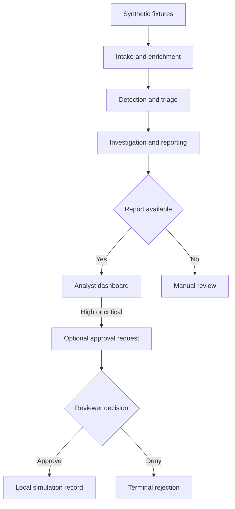

# Phase 1 architecture

FastAPI -> validated SecurityEvent -> SQLite append-only-by-API EventRepository -> event hash response. The application is a modular monolith. Agent orchestration is an interface reserved for Phase 2. MockProvider returns a deterministic unverified result. FoundryProvider fails closed until Azure region, model quota and credential configuration are verified.

Future agents (not implemented): Intake, Enrichment, Detection, Triage, Investigation, Reporting. Human approval gates remain mandatory for any response action. Real response actions are excluded from the competition demo.

SQLite is for local demonstration only. Its SHA-256 digest detects accidental content changes only when independently compared against a trusted copy; it does not provide tamper-proof custody.

## Competition workflow (implemented locally)

The run ID groups six timed stages with case IDs, tool names, evidence references,
retry counts and failure categories. The dashboard replays versioned fixtures on
request. The prototype event API is independent of the fixture replay API.
Case reports are reproducible, while each replay receives fresh trace IDs and
timings. With a database path, local events and approvals survive restart.

## Transition to a pilot

Keep the fixture runner for CI. Validate Foundry availability, quota and a small
cost cap in an authorized Azure subscription before adding a cloud adapter. In
staging, require managed identity, per-role authorization, private connectivity,
approved retrieval sources, independent security review and telemetry redaction.
Put bounded remote calls behind the same typed contracts and enforce timeouts
inside the adapter. Compare against deterministic and single-agent baselines.
Capture severity overrides, escalation recall, unsupported claims, p95,
and cost per case. Start in shadow mode with approved data only and retain a
manual triage route. On regression or budget breach, disable the cloud adapter
and restore the last verified build.
