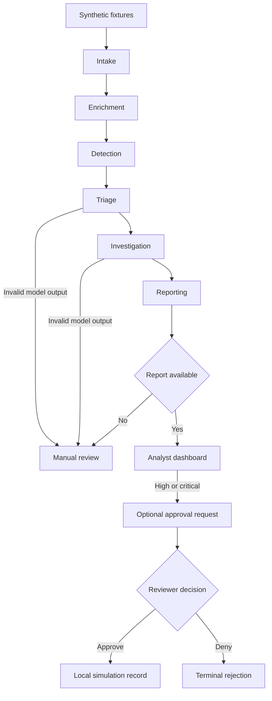

# Competition Edition architecture

FastAPI validates the synthetic fixture and invokes the six stages in the same
order for local and Foundry replays. In Foundry mode, two pinned prompt-agent
versions provide triage and investigation. Intake, enrichment, detection and
reporting use local rules and contracts. An analyst reviews model recommendations.
Independent reviewer approval is mandatory for recording a simulated response.

SQLite is for local demonstration only. Its SHA-256 digest detects accidental content changes only when independently compared against a trusted copy; it does not provide tamper-proof custody.

## Competition workflow

The run ID groups six timed stages with case IDs, tool names, evidence references,
retry counts and failure categories. The dashboard replays versioned fixtures on
request. The prototype event API is independent of the fixture replay API.
Local case reports are reproducible. Each replay receives a fresh trace ID.
Foundry advice and duration can vary between runs. With a database path, local events and approvals survive restart.

## Transition to a pilot

Keep the fixture runner for CI. Validate Foundry availability, quota and a small
cost cap in an authorized Azure subscription before admitting pilot data. In
staging, require managed identity, per-role authorization, private connectivity,
approved retrieval sources, independent security review and telemetry redaction.
Put bounded remote calls behind the same typed contracts and enforce timeouts
inside the adapter. Compare against deterministic and single-agent baselines.
Capture severity overrides, escalation recall, unsupported claims, p95,
and cost per case. Start in shadow mode with approved data only and retain a
manual triage route. On regression or budget breach, disable the cloud adapter
and restore the last verified build.
